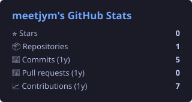
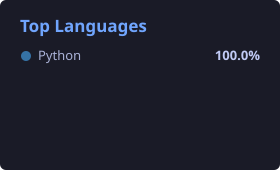

  

<!-- BING:START -->

  

🖼️ 必应每日一图 Bing Daily · 2026-10-29 · 薄雾邂逅千年时光 立石，埃夫伯里，威尔特郡，英格兰 (© George W Johnson/Getty Images)

<!-- BING:END -->

  

  
  

  喜欢折腾新工具、慢慢学习开源。 
  Enjoys tinkering with new tools and learning open source, one step at a time.

---

<h3 align="center">🌱 最近在探索 / Currently exploring</h3>

  🤖 AI 工具 AI tools &nbsp;·&nbsp;
  🌍 开源项目 open-source projects &nbsp;·&nbsp;
  🛠️ 实用小脚本 handy scripts

<h3 align="center">🧰 工具箱 / Toolbox</h3>

  

---

<h3 align="center">📊 GitHub Stats</h3>

  
  

  

<h3 align="center">🏆 Trophies</h3>

  

<!-- UPDATED:START -->

🕒 更新于 Updated: 2026-10-29 13:00 (UTC+8)

<!-- UPDATED:END -->

慢慢来，比较快。 Slow is smooth, smooth is fast.

  

